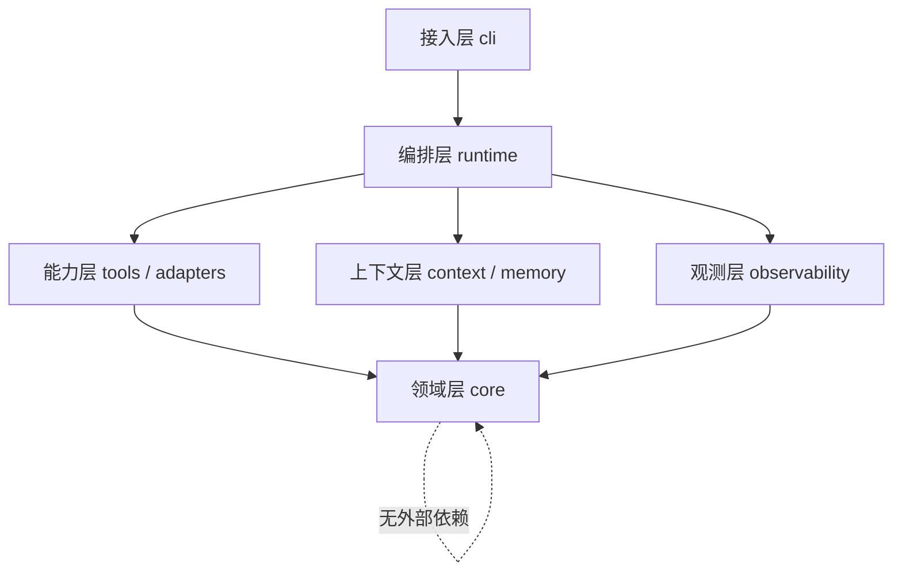
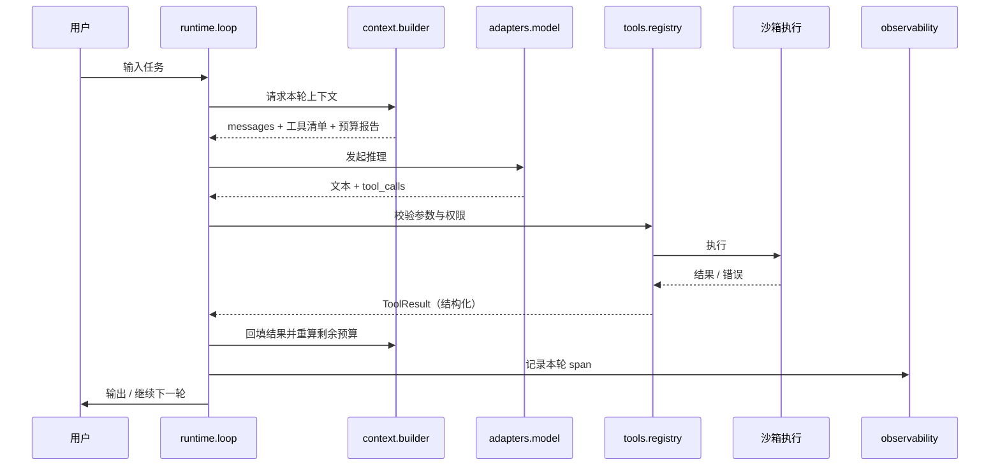

# 架构设计

> 状态：v0.0.1（D2 定稿）｜变更需走 ADR

## 设计原则

1. **每一层可被单独替换**：换模型、换存储、换工具体系、换观测后端，都不该动到 Loop。
2. **依赖只向下，不允许回环**：`core` 不依赖任何人，上层只依赖下层接口。
3. **一切决策可观测**：模型调用、工具执行、上下文裁剪、压缩，每个决策点都产出 span。
4. **失败是一等公民**：超时、非法参数、空返回、部分成功，都在类型系统里显式建模，而不是靠抛异常兜底。

## 六层

| 层 | 目录 | 职责 | 明确不做 |
|---|---|---|---|
| 接入层 | `src/cli` | 命令行入口、参数解析、输出渲染 | 不含业务逻辑，不直接调用模型 |
| 编排层 | `src/runtime` | Agent Loop、会话状态机、任务队列、断点续跑、子 Agent 调度 | 不关心工具怎么实现 |
| 能力层 | `src/tools`、`src/adapters` | 工具协议与注册中心、内置工具、模型 Provider、MCP 客户端/服务端、存储适配 | 不感知上下文预算 |
| 上下文层 | `src/context`、`src/memory` | 预算分配、裁剪、压缩、长期记忆写入与检索 | 不直接发请求给模型 |
| 领域层 | `src/core` | Message / ToolCall / ToolResult / Event / Trace 等纯类型与协议定义 | 不引入任何第三方依赖 |
| 观测层 | `src/observability` | trace 采集、replay、评测、成本核算 | 不改变执行结果 |

## 依赖方向



**硬规则**：`core` 的 import 列表里只允许出现标准库与自身；任何跨层调用必须通过接口，禁止直接 import 兄弟层的实现文件。

## 一次工具调用的完整链路



链路里每一个箭头都必须能对应到一个 trace span——这是 D85 验收的前提。

## 目录约定

```
personal-agent/
├── docs/
│   ├── architecture.md
│   └── adr/                  # 所有不可逆决策
├── src/
│   ├── cli/                  # 接入层
│   ├── core/                 # 领域层：纯类型与协议
│   ├── runtime/              # 编排层
│   ├── tools/                # 工具协议、注册、内置工具
│   ├── context/              # 预算、裁剪、压缩
│   ├── memory/               # 长期记忆与检索
│   ├── adapters/             # 模型、MCP、存储
│   └── observability/        # trace / replay / eval / cost
└── test/
```

## 关键取舍

- **为什么 Loop 在 runtime 而不在 core**：Loop 会随策略变化（串行 / 并行 / 子 Agent），属于可替换的编排策略；core 只保留数据结构，避免策略污染模型层。
- **为什么上下文层独立**：上下文是 Agent 效果的第一变量，必须有独立预算与度量能力，否则会被散落在各处的字符串拼接淹没。
- **为什么观测层不侵入执行**：trace 通过事件订阅采集，观测失败不能影响任务执行。

## 待定（后续 ADR 决策）

- ADR-001：工具粒度与注册方式（W5）
- ADR-002：上下文压缩策略（W9）
- ADR-003：多 Agent 是否进入 v1（W12）
