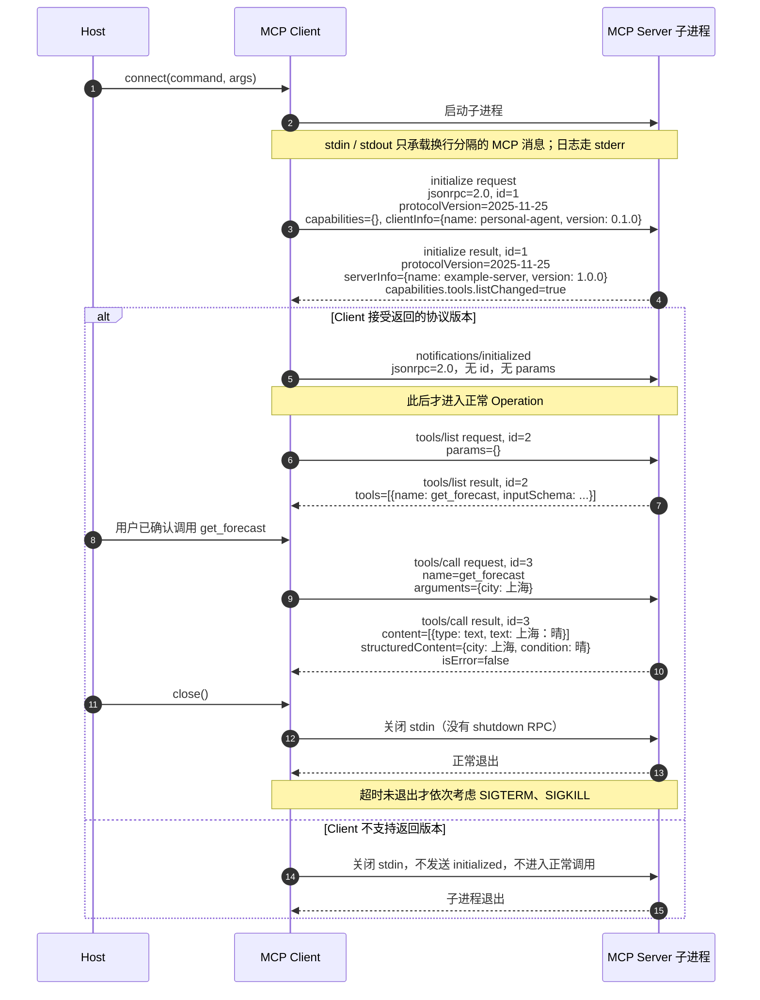
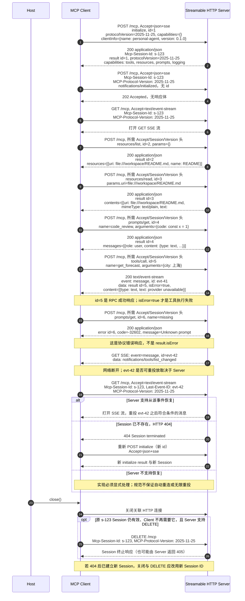

# D034 · MCP 调用时序图

> 协议笔记：[D034 MCP 协议走读](./d034-mcp-protocol.md)
> 主读版本：**2025-11-25**；资料访问日期：**2026-11-12**
> 图源：作者依据官方 [Lifecycle](https://modelcontextprotocol.io/specification/2025-11-25/basic/lifecycle)、[Transports](https://modelcontextprotocol.io/specification/2025-11-25/basic/transports)、[Tools](https://modelcontextprotocol.io/specification/2025-11-25/server/tools)、[Resources](https://modelcontextprotocol.io/specification/2025-11-25/server/resources) 与 [Prompts](https://modelcontextprotocol.io/specification/2025-11-25/server/prompts) 绘制；无外链图片。

## 图 1 · stdio：初始化到 `tools/call`

下图使用与协议笔记相同的 `protocolVersion`、`clientInfo`、工具名和参数。`id = 1…3` 仅是一次 Session 内的示例；Notification 没有 `id`，也不存在对它的 Response。

### 读图检查

- `initialize` 是第一次交互；Client 等成功响应后才发送 `notifications/initialized`。
- `tools/list` 和 `tools/call` 的 Response 都通过 `id` 配对，而不是靠“下一条消息”猜测。
- 图中的 `isError=false` 位于 `result` 内；若是 JSON-RPC `error`，外层就不是 Tool Result。
- `close()` 是传输关闭，不是发送一个名为 `shutdown` 的 MCP Request。

官方依据：[Lifecycle](https://modelcontextprotocol.io/specification/2025-11-25/basic/lifecycle)、[stdio framing](https://modelcontextprotocol.io/specification/2025-11-25/basic/transports#stdio)、[Tools · Message Flow](https://modelcontextprotocol.io/specification/2025-11-25/server/tools#message-flow)。

---

## 图 2 · Streamable HTTP：Session、资源/提示、错误与 SSE 重连

本图假设 Server 在初始化时分配 `Mcp-Session-Id: s-123`，支持 GET SSE，并给可恢复事件分配 ID。后两项是 Server 可选择提供的能力，不能据此推断所有 Server 都支持。每个 POST 仍带 `Accept: application/json, text/event-stream`；为突出协议字段，图中将该重复头简写为 `Accept=json+sse`。

### 读图检查

- `initialized` 是 Notification，所以 HTTP `202 Accepted` 后没有 JSON-RPC Response。
- `resources/read` 返回 `contents[].text`，不是工具 Content Block 的 `type: "text"`。
- `tools/call` 的 `result.isError=true` 与 `prompts/get` 的外层 `error.code=-32602` 是两条不同错误通道。
- `Last-Event-ID` 只用于可恢复 SSE 流；HTTP 404 Session 失效要求重新初始化。
- 旧 2024-11-05 HTTP+SSE 的 `endpoint` 事件不属于此图；本图始终是单 MCP endpoint 的 Streamable HTTP。

官方依据：[Sending Messages](https://modelcontextprotocol.io/specification/2025-11-25/basic/transports#sending-messages-to-the-server)、[Listening](https://modelcontextprotocol.io/specification/2025-11-25/basic/transports#listening-for-messages-from-the-server)、[Resumability and Redelivery](https://modelcontextprotocol.io/specification/2025-11-25/basic/transports#resumability-and-redelivery)、[Session Management](https://modelcontextprotocol.io/specification/2025-11-25/basic/transports#session-management)、[Protocol Version Header](https://modelcontextprotocol.io/specification/2025-11-25/basic/transports#protocol-version-header)。

---

## 图示边界

这些图是依据规范绘制的教学示例，**不是抓包记录**。D034 没有运行 Client、没有连接外部 Server、没有观察到真实 `s-123` 或 `evt-42`；这些值都是明确标注的示例。最新 2026-07-28 的逐请求、无初始化握手模型不在图中，版本差异见[协议笔记第 1 节](./d034-mcp-protocol.md#1-版本范围先分清两代协议)。
